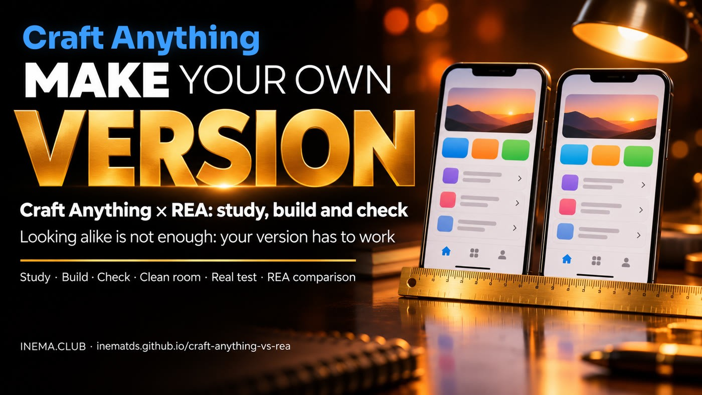

# craft-anything-vs-rea

[](https://inematds.github.io/craft-anything-vs-rea/guia/en/)

**🇧🇷 [Português](README.md) · 🇺🇸 [English](README.en.md) · 🇪🇸 [Español](README.es.md)**

## 🎬 Watch the video

**Craft Anything: point at an app and AI makes your own version** (in Portuguese): https://www.youtube.com/watch?v=Jx_lYjw6ioQ · vertical version: https://www.youtube.com/watch?v=0atFUnqDXv8

## What it is

**Craft Anything** is a free, open-source program that looks at a website, app, or game, asks an AI agent (such as Claude Code) to build its own version from scratch, and compares the result with the original. This repository is a guide to installing and using it safely, a comparison with **REA** (another open-source tool that shows how a program works internally), and a real-world test run here. The toolkit includes a similarity scorecard and a list of features to check the copy with any agent. You need a computer and a logged-in coding agent; the toolkit requires Node.js and Python 3.

## 📖 User guide

Complete guide (landing page + step-by-step instructions): **https://inematds.github.io/craft-anything-vs-rea/guia/en/**

## What’s included

| File | What it’s for |
|---|---|
| [`conferir/semelhanca.js`](conferir/semelhanca.js) | Compares the original with your version at 1440, 820, and 390 px: a **structure** score, a **color** score, side-by-side screenshots, and a map of differences. Exit code 0/1/2. |
| [`conferir/funcoes.py`](conferir/funcoes.py) | Generates a feature checklist (the `quadro-branco` template with 16 features and the `generico` template) and fails until every feature has proof. |
| [`conferir/exemplos/funcoes-contador.js`](conferir/exemplos/funcoes-contador.js) | Automated feature test used in the real-world test (template to copy). |
| [`pedidos/`](pedidos/en/) | 5 ready-to-use prompts: clean room, similarity target, brand change, feature proof, and whiteboard test (PT, EN, and ES). |
| [`COMPARACAO.md`](COMPARACAO.md) (in Portuguese) | Craft Anything × REA × our toolkits, based only on primary-source facts (10/11/2026). |
| [`TESTE-AQUI.md`](TESTE-AQUI.md) (in Portuguese) | The real-world test of Craft Anything 0.6.0 on this machine, including numbers and what blocked it. |
| [`tests/rodar.sh`](tests/rodar.sh) | Toolkit tests (offline). |

## Quick start

```bash
git clone https://github.com/inematds/craft-anything-vs-rea && cd craft-anything-vs-rea
npm install -g playwright && npx playwright install chromium   # one time only

# 1) Does it look similar? (structure at all 3 widths; exit code 0 = passed)
node conferir/semelhanca.js https://original.exemplo minha-versao/index.html --meta 85 --saida conferencia

# 2) Does it work? (the agent marks [x] and writes the proof on each line)
python3 conferir/funcoes.py gerar quadro-branco --nome "Rabisco" --saida checklist.md
python3 conferir/funcoes.py conferir checklist.md

# toolkit tests
bash tests/rodar.sh
```

## The process, from start to finish

Who does what: 🧠 you (or a session with Nei) · ⚙️ script · 🤖 coding agent (Claude Code through the subscription).

1. 🧠 Choose the original and confirm you’re allowed to study it (it belongs to you, it’s open source, or you’re only looking at what a visitor can see).
2. 🧠 Install Craft Anything from the releases page and verify the SHA256 (`sha256sum` × `SHA256SUMS.txt`).
3. 🧠 Install and log in to Claude Code (`claude auth status`); in the app, Settings → AI → Harnesses → Detect.
4. 🧠 Settings → Safety → Auto mode **off**; Settings → General → project folder.
5. 🤖 Make → Clean room → prompt (`pedidos/1-sala-limpa.md` or `pedidos/5-teste-do-quadro-branco.md`) → Start: Craft Anything studies the original, the agent builds, and Craft Anything checks the result.
6. ⚙️ `node conferir/semelhanca.js <original> <sua versão> --meta 85` → table + `diferencas-*.png`.
7. ⚙️ `python3 conferir/funcoes.py gerar <modelo> --nome X --saida checklist.md`.
8. 🤖 The agent tests each feature and writes its proof (`pedidos/4-provas-de-funcao.md`).
9. ⚙️ `python3 conferir/funcoes.py conferir checklist.md` → exit code 0 only when every feature has proof.
10. 🤖 Change the brand (`pedidos/3-mudanca-de-marca.md`), then repeat steps 6 and 9.
11. ⚙️ Before changing the toolkit: `bash tests/rodar.sh` → "ALL GOOD".

## Craft Anything × REA in 4 lines

- **Craft Anything** (`storytold/craft-anything`, Rust, MIT or Apache-2.0, 0.6.0 "early alpha"): studies the original, asks an agent to build a copy, and **checks it on its own**; clean room by default.
- **REA** (`morluto/rea`, TypeScript, MIT): gives **your** agent reverse-engineering tools (Hopper, Ghidra, IDA, Kuna…); the agent studies the program and can build its own version.
- REA came first (14/04/2026 × 31/10/2026): Craft Anything is not "the father of REA."
- Neither is a sealed box: the agent acts as you. Details in [COMPARACAO.md](COMPARACAO.md) (in Portuguese).

## Related toolkits

[rea-engenharia-reversa](https://inematds.github.io/rea-engenharia-reversa/guia/) ·
[rea-com-provas](https://inematds.github.io/rea-com-provas/guia/) ·
[rea-sem-travas](https://inematds.github.io/rea-sem-travas/guia/) (all local: dsh + Ollama + REA) ·
[caixa-do-agente](https://inematds.github.io/caixa-do-agente/guia/) ·
[site-inspirado](https://inematds.github.io/site-inspirado/guia/) ·
[site-que-vende](https://inematds.github.io/site-que-vende/guia/)

## License

MIT. Craft Anything and REA are third-party projects with their own licenses.
Made for the [INEMA.CLUB](https://inema.club) community.